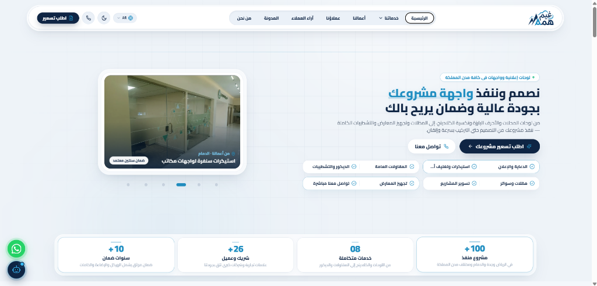
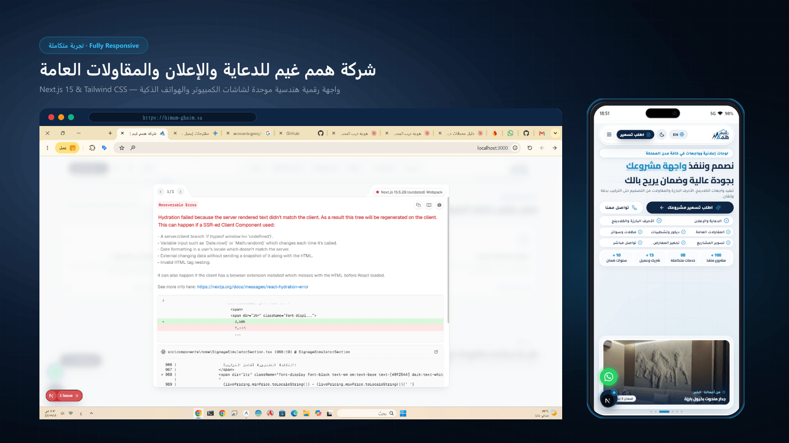
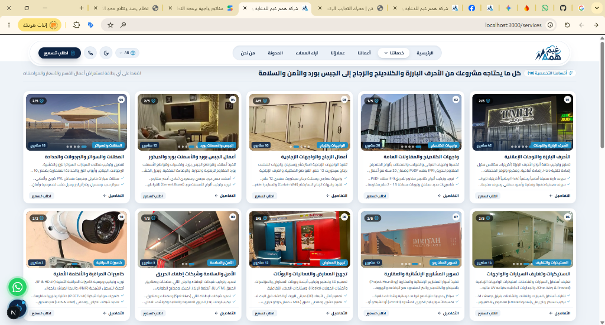
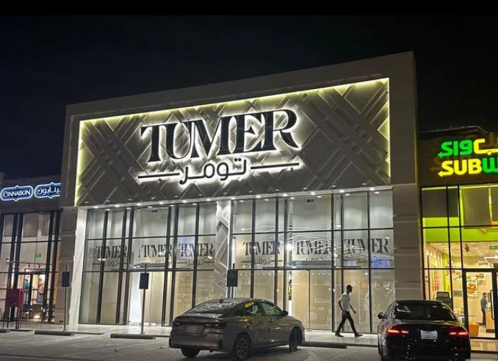
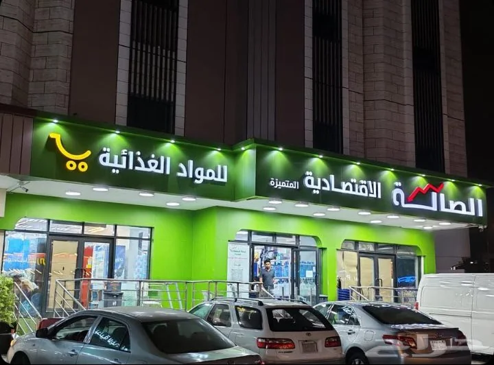
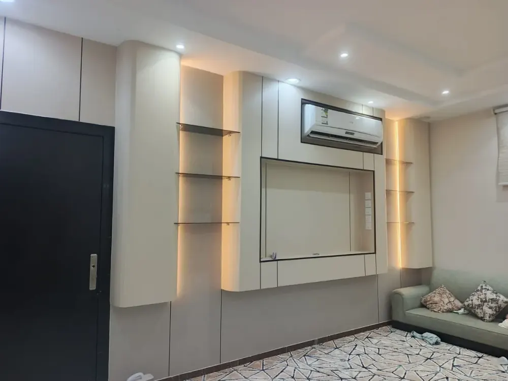
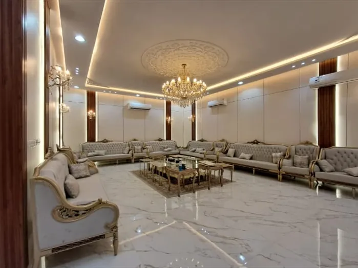
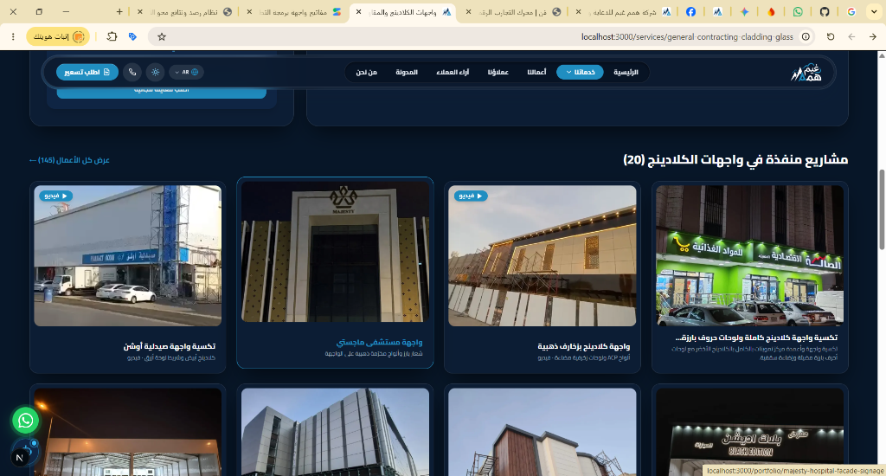

# شركة همم غيم للدعاية والإعلان والمقاولات العامة
### Himam Ghaim Signage, Advertising & General Contracting Platform

<div align="center">



<br />



[](https://nextjs.org/)
[](https://tailwindcss.com/)
[](https://www.typescriptlang.org/)
[](https://ai.google.dev/)
[](https://hmm-ghym-sa--my-saudi-node.us-east4.hosted.app/sitemap.xml)

**🌐 الرابط الرسمي للمنصة:** [https://hmm-ghym-sa--my-saudi-node.us-east4.hosted.app](https://hmm-ghym-sa--my-saudi-node.us-east4.hosted.app)

</div>

---

## 🏛️ نبذة عن المنصة والشركة
منصة رقمية هندسية متكاملة تُمثّل **شركة همم غيم للدعاية والإعلان والمقاولات العامة** في المملكة العربية السعودية (الرياض، جدة، الدمام، وكافة مناطق المملكة) تحت شعار **«من الحرف البارز إلى تسليم المفتاح»**.

تجمع المنصة بين الهوية المعمارية الخزفية الفاخرة (**Porcelain & Royal Navy Aesthetics**)، وسرعة الأداء العالية، وأدوات الذكاء الاصطناعي الهندسي، ومنظومة أرشفة متقدمة في محركات البحث (**Enterprise Google SEO**) لعرض **11 قسماً هندسياً وتنفيذياً** وأكثر من **145 مشروعاً موثقاً بالصور والفيديو**.

---

## 🏗️ الأقسام الهندسية والتنفيذية الـ 11 (11 Specialized Departments)



تمت هيكلة خدمات الشركة في **11 قسماً تخصصياً مستقلاً**، لكل قسم صفحته الهندسية، أسعاره التقديرية، أسئلته الشائعة، تبويباته الفنية، وقطار أعماله المنفذة:

| # | القسم الهندسي | الرابط المباشر | أبرز التخصصات والمواصفات الفنية |
| :-: | :--- | :--- | :--- |
| **01** | **الأحرف البارزة واللوحات الإعلانية** | `/services/signage-3d-letters-cladding` | تصنيع وتركيب 8 أنواع من الحروف البارزة (أكريليك مضيء، ستانلس ستيل 304، إضاءة خلفية Halo، زنكور، نيون فليكس، حروف مخرمة، وعواميد أسعار محطات الوقود Totem) بضمان 5–10 سنوات. |
| **02** | **واجهات الكلادينج والمقاولات العامة** | `/services/general-contracting-cladding-glass` | تكسية واجهات المباني والمولات ومحطات الوقود بألواح الكلادينج المقاوم للحريق (`FR PVDF`) على شاسيهات حديد مجلفن ثقيل بضمان مصنعي يصل إلى 20 سنة. |
| **03** | **أعمال الزجاج والواجهات الزجاجية** | `/services/structural-glass-facades-partitions` | تنفيذ واجهات الزجاج الاستركشر (`Curtain Wall`) والسبايدر (`Spider Glass`)، واجهات المعارض بزجاج سيكوريت 12 ملم، القواطع المكتبية، والغرف الزجاجية. |
| **04** | **أعمال الجبس بورد والأسمنت بورد** | `/services/interior-design-decor-finishing` | تنفيذ الأسقف المستعارة وبيوت النور المخفية والمسارات المغناطيسية (`Magnetic Track`)، وقواطع وملاحق الأسمنت بورد المقاومة للرطوبة والحرارة والحريق، والجداريات الجبسية ثلاثية الأبعاد. |
| **05** | **تكسيات بديل الشيبورد والخشب والرخام** | `/services/chipboard-wood-marble-cladding` | توريد وتركيب ألواح بديل الشيبورد الكوري والألماني، تفصيل مكتبات وخلفيات شاشات التلفزيون بزوايا مقوسة وفواصل ألمنيوم سوداء، تنفيذ الأبواب المخفية (`Hidden Doors`)، ودمج بديل الخشب المضلع (`WPC`) والحجر الصخري (`PU Stone`). |
| **06** | **المظلات والسواتر والبرجولات والحدادة** | `/services/car-shades-pergolas-screens` | تفصيل مظلات مواقف السيارات (`PVC` كوري وألماني و`HDPE`)، سواتر قص الليزر، البرجولات المودرن للحدائق، والحدادة المعمارية بدهانات فرن حرارية. |
| **07** | **الاستيكرات وتغليف السيارات والواجهات** | `/services/stickers-vehicle-wrapping-murals` | تغليف أساطيل السيارات والشاحنات بفينيل ألماني وأمريكي (`3M / Orafol`)، استيكرات الزجاج الرملي (`Frosted`) وون واي فيجن (`One-Way Vision`)، والجداريات الداخلية. |
| **08** | **تسوير المشاريع الإنشائية والعقارية** | `/services/project-hoarding-construction-fencing` | تنفيذ أسوار المواقع الإنشائية (`Project Hoarding`) بالشينكو والكلادينج والبنر الكوري المشدود مع الإضاءة والهوية البصرية للمطورين العقاريين. |
| **09** | **تجهيز المعارض والفعاليات والبوثات** | `/services/exhibition-booths-stands-events` | تصميم ثلاثي الأبعاد (`3D`) وتصنيع وتركيب أجنحة وبوثات المعارض والمؤتمرات، أكشاك المولات (`Kiosks`)، وستاندات العرض التفاعلية. |
| **10** | **الأمن والسلامة وشبكات إطفاء الحريق** | `/services/security-cctv-fire-safety-systems` | تمديد وتركيب شبكات الإطفاء والرش الآلي (`Sprinklers`)، مضخات وصناديق الحريق (`UL/FM`)، أنظمة الإنذار المبكر، ومخارج الطوارئ المعتمدة. |
| **11** | **كاميرات المراقبة والأنظمة الأمنية** | `/services/cctv-security-surveillance-cameras` | توريد وتركيب وبرمجة كاميرات المراقبة الشبكية (`IP CCTV 4K`) الداخلية والخارجية المقاومة للعوامل الجوية مع أجهزة التسجيل (`NVR`) والربط المباشر بالجوال. |

---

## 🖼️ نماذج حية من المعرض والأقسام المنفذة (Executed Portfolio Showcase)

<div align="center">
<table>
  <tr>
    <td align="center" width="33%">
      
      <br />
      <b>01 • الأحرف البارزة واللوحات الإعلانية</b>
      <br />
      <sub>حروف بارزة مضيئة بإضاءة خلفية Halo وواجهة كلادينج</sub>
    </td>
    <td align="center" width="33%">
      
      <br />
      <b>02 • واجهات الكلادينج والمقاولات</b>
      <br />
      <sub>تكسية واجهة مركز تجاري كامل بألواح كلادينج ACP</sub>
    </td>
    <td align="center" width="33%">
      
      <br />
      <b>05 • تكسيات بديل الشيبورد</b>
      <br />
      <sub>وحدة جدار تلفزيون بتكسيات الشيبورد وزوايا مقوسة وإضاءة مخفية</sub>
    </td>
  </tr>
  <tr>
    <td align="center" width="33%">
      
      <br />
      <b>04 • الجبس بورد والأسمنت بورد</b>
      <br />
      <sub>تنفيذ أسقف جبس بورد فاخرة مع بيوت نور وإضاءة مخفية</sub>
    </td>
    <td align="center" width="33%">
      
      <br />
      <b>03 • الواجهات الزجاجية والسيكوريت</b>
      <br />
      <sub>واجهات وأبواب زجاج سيكوريت 12 ملم أوتوماتيكية</sub>
    </td>
    <td align="center" width="33%">
      
      <br />
      <b>09 • تجهيز المعارض والبوثات</b>
      <br />
      <sub>تصميم وتصنيع أجنحة وبوثات معارض احترافية بالرياض</sub>
    </td>
  </tr>
</table>
</div>

---

## ✨ أبرز المزايا الهندسية والتقنية في المنصة

### 1. 🎠 نظام المعارض المتعددة المتقلبة تلقائياً (`AutoMediaCarousel`)
- يدعم كل مشروع وكل قسم هندسي وكل نوع من أنواع الأحرف البارزة إضافة **عدة صور وفيديوهات** داخل البطاقة الواحدة.
- تتقلب الصور تلقائياً بنعومة (`Crossfade`) مع إيقاف مؤقت عند تمرير الماوس، وأزرار تنقل يدوية، وعداد رقمي نظيف (`1/6`).
- في لوحة التحكم ([`SmartGalleryUploader.tsx`](src/components/admin/SmartGalleryUploader.tsx))، يتم **ضغط الصور تلقائياً بصيغة WebP** في المتصفح قبل الرفع لضمان أقصى سرعة تصفح.

### 2. 🚆 قطار الأعمال المنفذة وتبويبات أنواع الحروف الـ 8

- **قطار أعمال القسم (`Service Executed Projects Train`):** داخل صفحة كل خدمة (`/services/[slug]`)، تتحرك المشاريع المنفذة المتعلقة بالقسم في **صف أفقي واحد متصل ومتحرك تلقائياً** (مثل قطار شركاء النجاح) يتوقف عند التمرير ليسمح باستعراض أي مشروع بضغطة واحدة دون تكديس الصفحات ببطاقات ثابتة.
- **دليل وتبويبات أنواع الأحرف البارزة الـ 8 ([`LetterTypesTabsSection.tsx`](src/components/services/LetterTypesTabsSection.tsx)):** قسم تفاعلي يعرض الـ 8 أنواع (أكريليك مضيء أمامي، إضاءة خلفية Halo، ستانلس ستيل 304، زنكور مطلي حرارياً، حروف مخرمة، إضاءة جانبية، نيون فليكس، وتوتم محطات الوقود) مع صور حقيقية ومواصفات فنية لكل نوع.

### 3. 🤖 التعبئة الذكية بالذكاء الاصطناعي الملتزمة بعنوان العميل (`Context-Aware AI Autofill`)
- عبر المسار [`/api/ai-project-autofill`](src/app/api/ai-project-autofill/route.ts) ونماذج **Google Gemini Vision**:
  - يقرأ الذكاء الاصطناعي الصور المرفقة **ويستفيد مباشرة من العنوان الذي يكتبه المدير** (مثل: *"عمل عامود أسعار لمحطة درب الوقود"*).
  - يلتزم بنسبة 100% بنوع العمل المحدد في العنوان وباسم العميل دون تغييره، ويستخرج من الصورة المواصفات الهندسية الدقيقة، ومدة التنفيذ، والضمان، والترجمة لـ 3 لغات (العربية، الإنجليزية، والأردية).

### 4. 🔍 منظومة السيو الشاملة لمحرك بحث جوجل (`Enterprise Google Search SEO`)
- **الترابط الداخلي السياقي الذكي ([`SmartLinkedText.tsx`](src/components/seo/SmartLinkedText.tsx) و [`seo-links.ts`](src/lib/seo-links.ts)):**
  - يحول الكلمات المفتاحية داخل مقالات المدونة الـ 20، وأوصاف الخدمات، وصفحات المشاريع تلقائياً إلى روابط داخلية نظيفة تشير إلى صفحات الأقسام الـ 11 وحاسبة التكلفة والمهندس الذكي دون تكرار أو إزعاج بصري.
- **بطاقة الهاشتاقات التخصصية ذات الانسدال الضخم ([`ExpandableHashtagsCard.tsx`](src/components/seo/ExpandableHashtagsCard.tsx)):**
  - تعرض الوسوم الأساسية ظاهرة في البطاقة، مع زر انسدال يفتح **أكثر من 220 هاشتاقاً وكلمة مفتاحية تخصصية** محفوظة بالكامل داخل شجرة الصفحة (`DOM-Preserved`) ومربوطة داخلياً ليستفيد منها Googlebot بنسبة 100%.
- **بصمة الـ 6 أسماء لكل صورة (`3 Arabic + 3 English SEO Names`):**
  - كل صورة في الموقع مزودة بـ **3 تسميات سيو عربية و3 إنجليزية** محقونة داخل سمات `alt` و`title` وبيانات `ImageObject JSON-LD` وخريطة الصور `sitemap.xml`.
- **الروابط الأساسية الموحدة (`User-Declared Canonical URLs`):**
  - جميع صفحات الموقع الـ **187** تحتوي على وسم `alternates.canonical` الرسمي الموجه إلى `https://hmm-ghym-sa--my-saudi-node.us-east4.hosted.app` مع بيانات `FAQPage` و`TechArticle` و`BreadcrumbList` و`LocalBusiness`.

### 5. 🖥️ ضبط الأبعاد البصرية (10% Desktop Proportional Scaling & Mobile Native Grid)
- **على الكمبيوتر (`>= 1024px`):** تم ضبط مقياس العرض الإجمالي (`zoom: 0.9`) ليمنح توازناً بصرياً مريحاً ومساحات تنفس مثالية، مع جعل جميع بطاقات الأقسام والمشاريع قابلة للضغط بالكامل في كافة أجزائها.
- **على الجوال (`< 640px`):** واجهة تطبيق أصلي (`100dvh Hero`) مع نظام شبكات ثلاثية متجاورة (`3-Column Mobile Grids`).

---

## 🛠️ البنية التقنية وهيكل المشروع (Project Architecture)

```text
├── data/
│   └── db.json                          # قاعدة البيانات الحية (11 قسماً، 145 مشروعاً، 20 مقالاً، 8 أنواع حروف)
├── public/
│   └── assets/
│       ├── images/
│       │   ├── portfolio/               # صور المشاريع المضغوطة بصيغة WebP ومسمّاة لمحركات البحث
│       │   └── docs/                    # لقطات شاشة التوثيق والاستعراض للمستودع
├── src/
│   ├── app/
│   │   ├── page.tsx                     # الصفحة الرئيسية + الميتا المتناوبة + Canonical
│   │   ├── layout.tsx                   # الغلاف العام + خطوط Cairo/Tajawal + إعدادات Googlebot
│   │   ├── sitemap.ts                   # خريطة الموقع الديناميكية (187 رابطاً + خريطة الصور Image Sitemap)
│   │   ├── robots.ts                    # توجيه عناكب البحث
│   │   ├── services/                    # صفحة شبكة الأقسام الـ 11 + صفحات الأقسام الفرعية [slug]
│   │   ├── portfolio/                   # معرض الأعمال العام + صفحات المشاريع الفرعية [slug]
│   │   ├── blog/                        # الموسوعة الهندسية + مقالات الخبراء الـ 20 [slug]
│   │   ├── calculator/                  # حاسبة التكلفة التقديرية الفورية للأقسام الـ 11
│   │   ├── ai-engineer/                 # المستشار الهندسي الذكي 24/7
│   │   ├── admin/                       # لوحة التحكم الشاملة وإدارة المحتوى والذكاء الاصطناعي
│   │   └── api/
│   │       ├── ai-project-autofill/     # محرك Gemini Vision لتحليل الصور وتوليد الأوصاف من عنوان العميل
│   │       ├── ai-engineer/             # محرك المحادثة الهندسية الذكية
│   │       └── og/                      # مولد بطاقات المعاينة الاجتماعية (1200×630) بمكتبة Sharp
│   ├── components/
│   │   ├── common/AutoMediaCarousel.tsx # مكون تقليب الصور والفيديوهات التلقائي مع أسماء السيو الستة
│   │   ├── services/LetterTypesTabsSection.tsx # تبويبات وشبكة أنواع الأحرف البارزة الـ 8
│   │   ├── seo/
│   │   │   ├── SmartLinkedText.tsx      # محرك تحويل الكلمات المفتاحية إلى روابط داخلية تلقائياً
│   │   │   ├── ExpandableHashtagsCard.tsx # بطاقة الهاشتاقات التخصصية مع الانسدال الموسع
│   │   │   └── JsonLdSchema.tsx         # البيانات المنظمة الشاملة للشركة والخدمات والتقييمات
│   └── lib/
│       └── seo-links.ts                 # قاموس الروابط الداخلية الـ 95+ وموسوعة الهاشتاقات الـ 220+
```

---

## 🚀 التشغيل والتطوير المحلي (Local Development)

```bash
# 1. تثبيت الحزم الاعتمادية
npm install

# 2. تشغيل خادم التطوير المحلي (http://localhost:3000)
npm run dev

# 3. فحص التوافق البرمجي (TypeScript Check)
npx tsc --noEmit

# 4. بناء نسخة الإنتاج (Production Build)
npm run build
npm run start
```

---

## 📞 التواصل والاعتماد الرسمي
- **الشركة:** شركة همم غيم للدعاية والإعلان والمقاولات العامة (`Himam Ghaim Co.`)
- **المنصة الرسمية:** [https://hmm-ghym-sa--my-saudi-node.us-east4.hosted.app](https://hmm-ghym-sa--my-saudi-node.us-east4.hosted.app)
- **الجوال والواتساب الموحد:** `+966 56 546 7928`
- **البريد الإلكتروني:** `hmm.ghym.sa@gmail.com`
- **المقر والتغطية:** الرياض — المملكة العربية السعودية (تنفيذ معتمد وتغطية شاملة لكافة مناطق المملكة)
