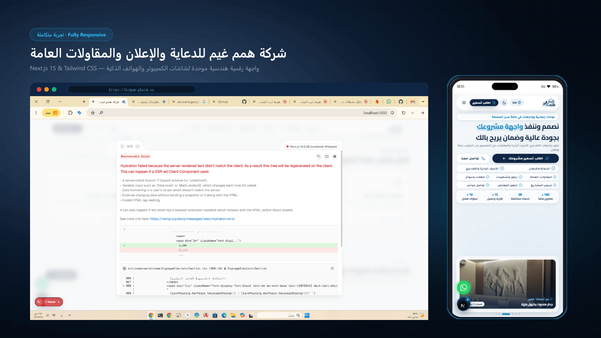

# شركة همم غيم للدعاية والإعلان والمقاولات العامة
### Himam Ghaim Signage, Advertising & General Contracting Platform

<div align="center">



[](https://nextjs.org/)
[](https://tailwindcss.com/)
[](https://www.typescriptlang.org/)
[](https://himam-ghaim.sa)
[](/api/og)

</div>

---

## 🏢 عن الشركة والمنصة
منصة رقمية هندسية متطورة تُمثّل **شركة همم غيم للدعاية والإعلان والمقاولات العامة** في المملكة العربية السعودية (الرياض — وتغطية شاملة لكافة المدن والمناطق).

تجمع المنصة بين أرقى معايير واجهات المستخدم (UI/UX) المستوحاة من العمارة الخزفية الفاخرة (Porcelain Aesthetics) والسرعة الفائقة لتقديم ثماني خدمات متكاملة تحت إدارة واحدة:
1. **الأحرف البارزة والواجهات والكلادينج:** زنكور، إكريليك، استيل مضيء، وكلادينج معتمد مقاوم للحريق بضمان حتى 10 سنوات.
2. **المظلات والسواتر والبرجولات:** تصاميم عصرية للفلل والمشاريع السكنية والتجارية بهياكل معالجة وقص ليزر.
3. **تسوير المشاريع الإنشائية:** حواجز شنكو أمنية مطابقة لاشتراطات منصة بلدي وبوسترات عملاقة UV.
4. **تجهيز المعارض والمؤتمرات:** تصنيع وتركيب بوثات ومنصات الفعاليات الكبرى.
5. **المقاولات العامة والتشطيبات:** واجهات زجاج سيكوريت، قواطع مكاتب، ديكورات بديل رخام وخشب، وتسليم مفتاح.
6. **أنظمة الأمن والسلامة:** كاميرات مراقبة وشبكات إطفاء حريق معتمدة من الدفاع المدني.
7. **الاستيكرات وتغليف أساطيل السيارات:** فينيل ألماني عالي الجودة 3M / Orafol وطباعة رولاند يابانية.
8. **الطباعة الرقمية واللافتات التجارية:** لوحات مطابقة لاشتراطات أمانات البلديات.

---

## 📱 تجربة الجوال المتناسقة (Mobile Experience)
تمت إعادة بناء وتنسيق الواجهة في وضع الجوال لتعطي إحساس التطبيقات الأصلية (Native App Experience):
- **قسم رئيسي ذكي (100dvh Hero):**
  - متوافق تلقائياً مع شاشات الهواتف مع احتواء كامل لبطاقة صور الأعمال.
  - شريط أرقام وإحصائيات متفاعل يقع مباشرة فوق صورة العمل.
  - شارات ضمان واقعية وديناميكية مستخرجة من طبيعة كل مشروع.
  - خروج بتمريرة واحدة سلسة (Single-Swipe Section Transition) للتنقل السريع بين الأقسام.
- **نظام شبكة البطاقات الثلاثية (3-Column Grid System):**
  - تم تحويل بطاقات الأقسام (لماذا همم غيم، خدماتنا الـ 8، سابقة الأعمال، وآراء العملاء) إلى نظام شبكة يعرض 3 بطاقات متجاورة في الصف الواحد مع أحجام خطوط منسقة (`text-[10px]` إلى `text-[11px]`) ونسب أبعاد دقيقة تمنع أي انكسار أو تشوه.
  - أنيميشن إضاءة متتابعة (Spotlight Animation) تفاعلية تلقائية وتتجاوب فوراً مع اللمس.
- **إخفاء مخصص لاستوديو التصميم على الجوال:**
  - استوديو تصميم اللوحات مخصص لشاشات الكمبيوتر والأجهزة اللوحية الكبيرة (1024px فما فوق)، ومخفي تماماً على الجوال بدون أي تلميح أو رسالة للمستخدم للحفاظ على انسيابية التصفح.

---

## 💻 تجربة الكمبيوتر والأجهزة اللوحية الكبيرة (Desktop Experience)
- تصميم فاخر متكامل بأربعة أعمدة واستعراض بصري للمشاريع.
- استوديو تصميم ومحاكاة ثلاثي الأبعاد للوحات المحلات والواجهات (Signage 3D Simulator):
  - اختيار الخطوط العربية التجارية والهندسية والخطاطية.
  - اختيار خامات الحرف (زنكور، إكريليك، استيل ذهبي وفضي).
  - ضبط أبعاد البروز (Depth) وعرض وارتفاع اللوحة.
  - حاسبة أسعار فورية تعتمد على المساحة واشتراطات التنفيذ.

---

## 🔄 نظام معاينة الروابط الديناميكي (Dynamic Open Graph & Social Preview)
عند مشاركة رابط المنصة عبر منصات التواصل (واتساب، تويتر/X، تيليجرام، لينكد إن، آي مسج):
- **توليد صور ديناميكي فائق الدقة (1200×630):** عبر المسار البرمجي المخصص [`/api/og`](src/app/api/og/route.ts) ومكتبة `sharp`.
- **دوران محتوى آلي (Dynamic 6-Hour Rotation):** تتغير المعاينة والصورة كل فترة لعرض زاوية مفيدة وجديدة للشركة:
  1. *واجهات الكلادينج والأحرف البارزة* مع صورة مقهى بلاك ستامب وشارة ضمان 10 سنوات.
  2. *المظلات والسواتر والبرجولات* مع صورة مشاريع الفلل وهياكل الحديد المعالج.
  3. *تسوير المشاريع الإنشائية والمعارض* مع صور حواجز الشنكو المعتمدة.
  4. *المقاولات العامة والتشطيبات* مع صور صالات العرض والواجهات الزجاجية.
  5. *تغليف أساطيل السيارات والاستيكرات* مع صور شاحنات النقل والفينيل الألماني.
- **عناوين وأوصاف تسويقية متغيرة تلقائياً:** عبر دالة `generateMetadata()` في [`src/app/page.tsx`](src/app/page.tsx) بما يدعم محركات البحث (SEO) ونسب النقر (CTR).

---

## 🛠️ البنية التقنية (Tech Stack)
| التقنية | الاستخدام |
| :--- | :--- |
| **Next.js 15.5 (App Router)** | إطار العمل الأساسي ومعالجة الخادم والصفحات الثابتة والديناميكية |
| **Tailwind CSS** | نظام التنسيق الحديث وتأثيرات العمق والظلال ثلاثية الأبعاد |
| **TypeScript** | الأمان النوعي للبيانات والمكونات |
| **Sharp** | محرك المعالجة والتوليد فائق السرعة لصور Open Graph ومعاينة الروابط |
| **Lucide Icons** | حزمة الأيقونات الهندسية خفيفة الوزن |

---

## 🚀 التشغيل والتطوير المحلي

```bash
# تثبيت الحزم
npm install

# تشغيل بيئة التطوير المحلية
npm run dev

# فحص وبناء المشروع للإنتاج
npm run build

# تشغيل خادم الإنتاج
npm run start
```

---

## 📞 التواصل والاعتماد
- **الموقع الإلكتروني:** [himam-ghaim.sa](https://himam-ghaim.sa)
- **الجوال والواتساب الموحد:** `+966 56 546 7928`
- **البريد الإلكتروني:** `hmm.ghym.sa@gmail.com`
- **المدينة:** الرياض — المملكة العربية السعودية (تنفيذ فوري وتغطية شاملة لكافة المدن)
